<p align="center">
  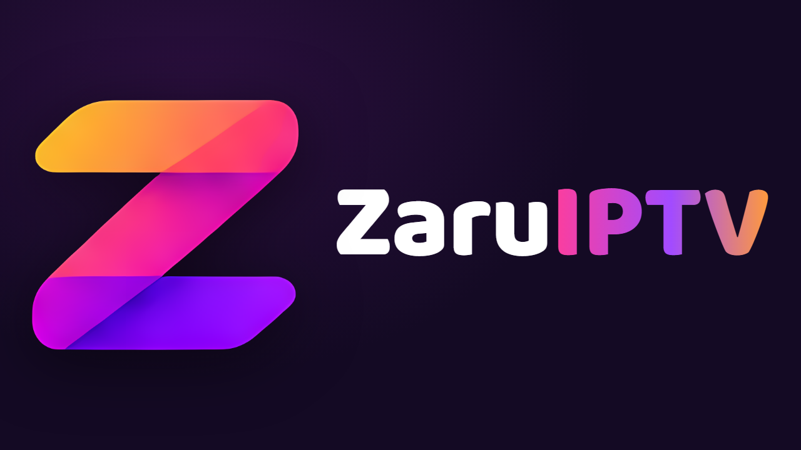
</p>

<h3 align="center">A fast, family-friendly IPTV player built for Android TV</h3>

<p align="center">
  <a href="https://github.com/smartq1/zaruiptv-surum/releases/latest"></a>
  
  
</p>

---

ZaruIPTV turns your Xtream Codes or M3U playlist into a clean, remote-first TV experience: live channels with a programme guide, movies and series with posters, separate profiles for everyone at home, voice search and automatic updates.

> **ZaruIPTV is a media player only.** It ships with no channels, movies or series and does not sell or provide any content. Everything you watch comes from a playlist that you add and are entitled to use.

## Contents

- [Screenshots](#screenshots)
- [Features](#features)
- [Installation](#installation)
- [Getting started](#getting-started)
- [Remote control](#remote-control)
- [Settings](#settings)
- [Updates](#updates)
- [Privacy](#privacy)
- [FAQ](#faq)

## Screenshots

> The screenshots use the built-in sample playlist, so channel and title names are placeholders.

| | |
|:---:|:---:|
| 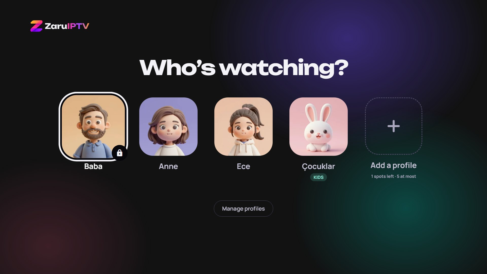 | 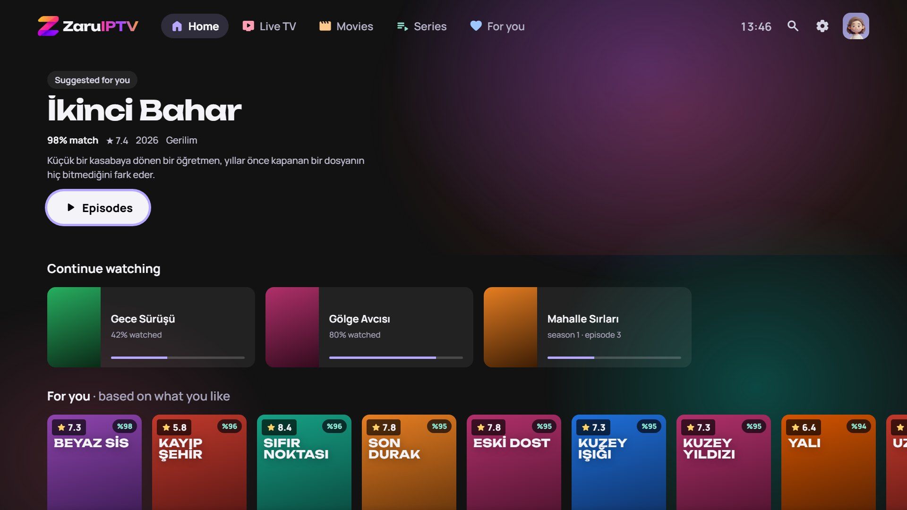 |
| **Who's watching?** Up to five profiles, optional PIN and a kids mode | **Home** Featured title, continue watching and personal suggestions |
| 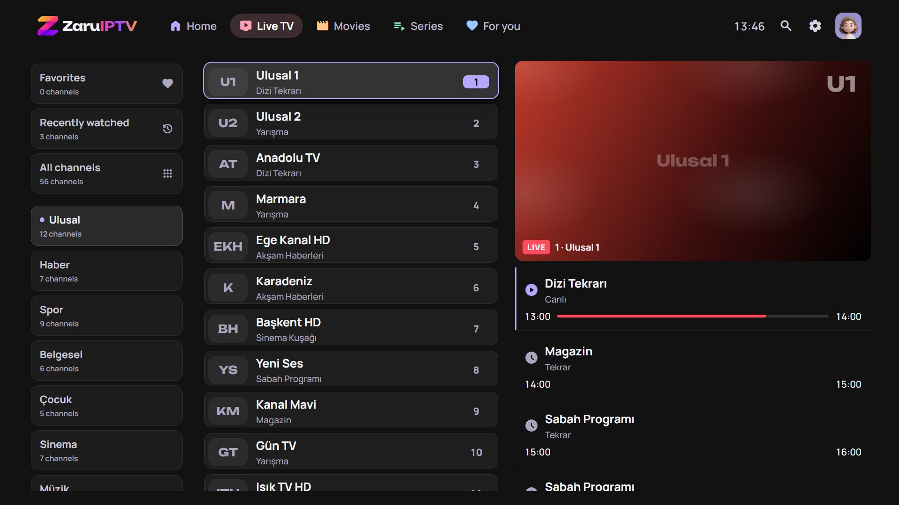 | 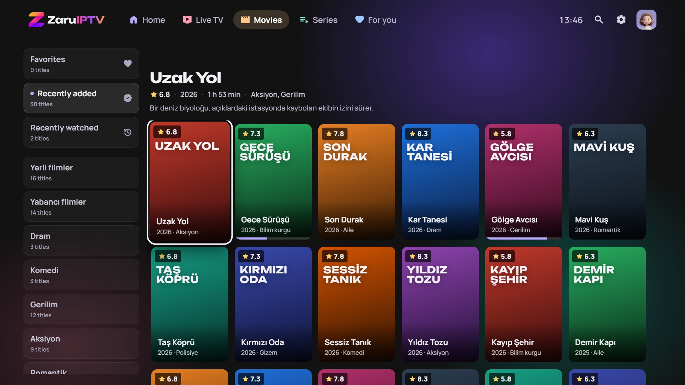 |
| **Live TV** Categories, channel list, live preview and programme guide | **Movies** Poster grid with categories, ratings and progress |
| 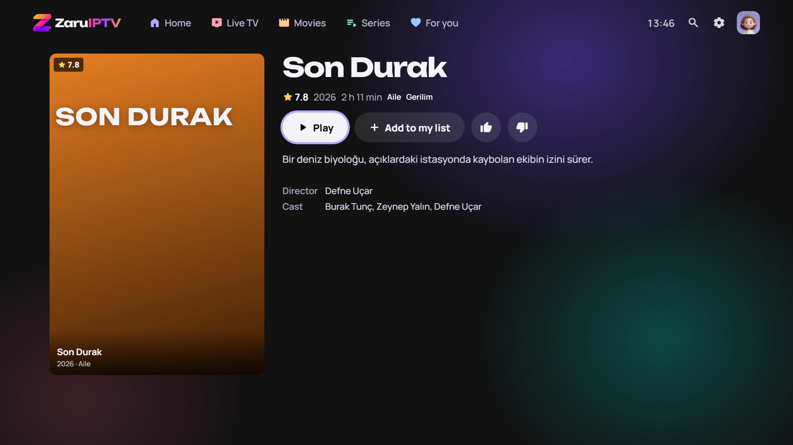 | 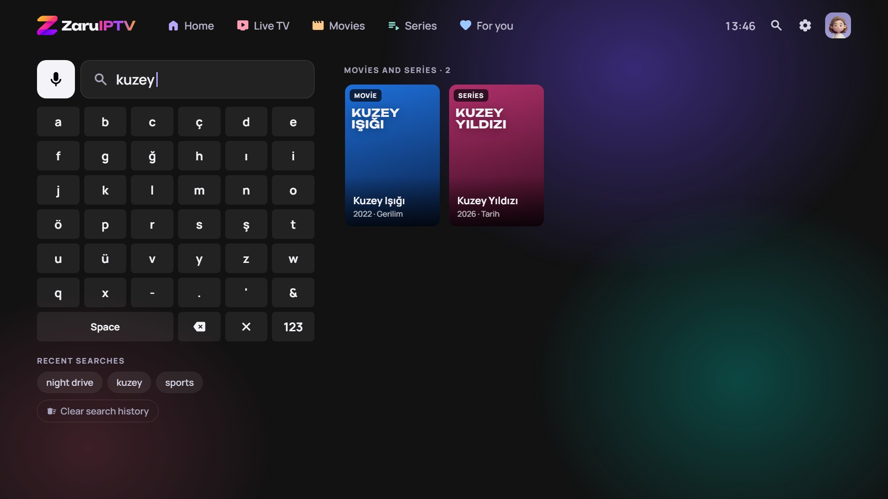 |
| **Details** Play, add to your list, like or dislike | **Search** On-screen keyboard, voice search and recent searches |
| 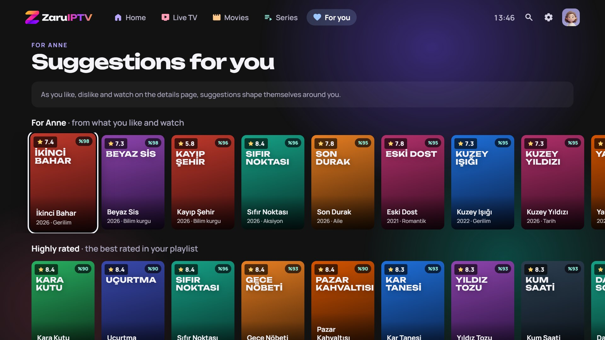 | 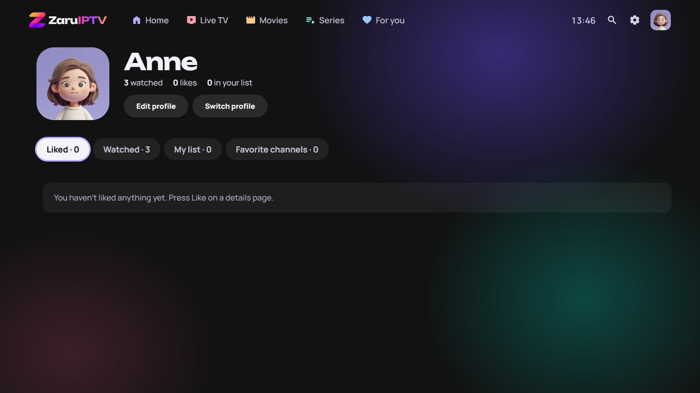 |
| **For you** Suggestions shaped by what you like and watch | **Profile** Liked, watched, your list and favourite channels |
| 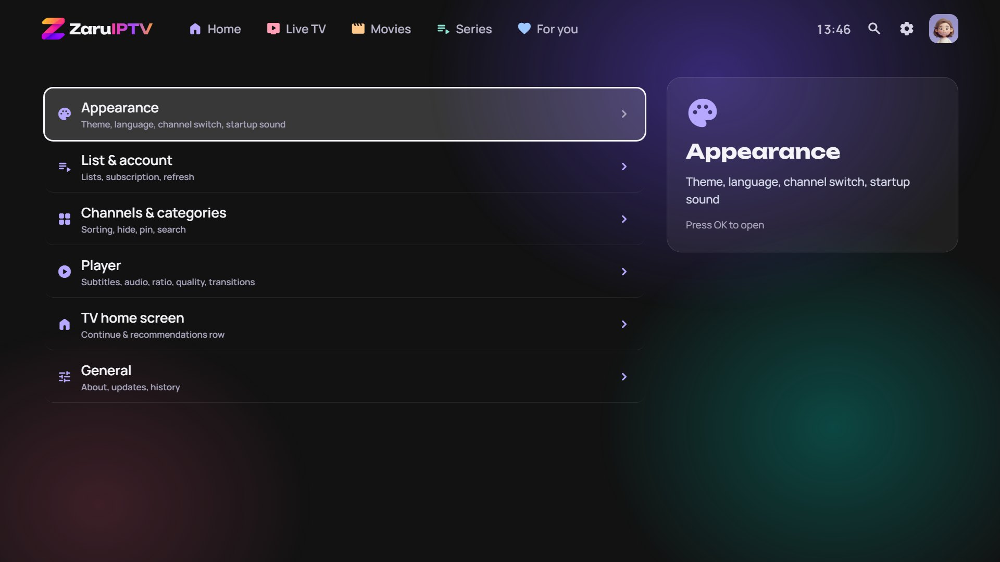 | 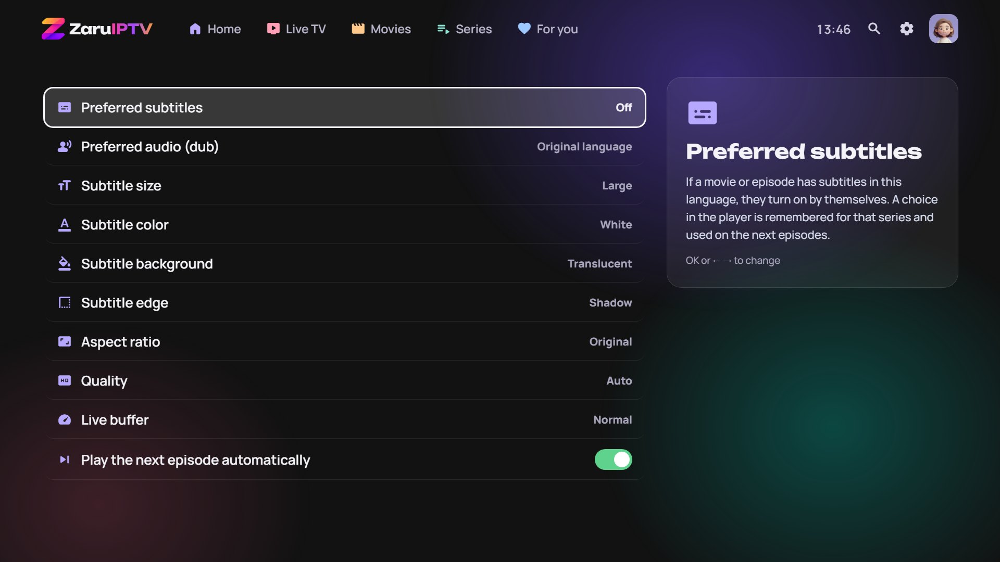 |
| **Settings** Grouped into clear categories | **Player** Subtitles, audio, aspect ratio, quality and more |

## Features

**Live TV**
- Channel categories with favourites and recently watched
- Live preview next to the channel list, then full screen with one more press
- Programme guide (EPG) with now / next and progress
- Quick channel list and track menu (subtitles, audio, quality) while watching
- Channel switch effects: the striped Z curtain, a simple fade, or instant

**Movies and series**
- Poster grids by category, sorted by default order, newest or rating
- Details page with cast, director, seasons and episodes
- Resume where you left off, on every profile separately
- Next episode autoplay with a countdown, and an "Are you still watching?" check
- Likes and dislikes feed the **For you** page

**Profiles**
- Up to five profiles, each with its own theme, history, list and favourites
- Optional four-digit PIN per profile; kids profiles
- 30+ illustrated avatars, or upload your own photo from your phone with a QR code

**Search**
- Instant results for channels, movies and series as you type
- Accent-insensitive, so `kuzey` also finds `Kuzey Işığı`
- **Voice search:** press the microphone next to the search box (or the remote's mic key on devices that pass it to apps), speak, and the box fills itself
- Recent searches as tappable chips, with a one-press **Clear search history**

**Android TV integration**
- "Continue watching" and suggestions on the TV home screen
- Opening a home-screen card resumes playback directly

**Everything else**
- Six interface languages: English, Türkçe, Deutsch, Français, Русский, العربية
- Several accent themes
- Multiple playlists; switch between them or give each profile its own
- Account status for Xtream playlists: expiry date, days left, open / allowed connections
- Attract screen when the menus are idle
- Startup animation with sound (can be muted)

## Installation

ZaruIPTV is not on the Play Store; you install the APK yourself. It runs on Android TV, Google TV and other Android-based TV devices with **Android 8.0 or newer** (Mi Box, Chromecast with Google TV, Philips, Sony, TCL and similar).

### Option 1: Downloader app (easiest)

1. On the TV, install **Downloader** by AFTVnews from the Play Store.
2. Allow it to install apps: *Settings → Apps → Security & restrictions → Unknown sources → Downloader*. The exact path varies slightly by brand.
3. Open Downloader and enter this address:
   ```
   https://github.com/smartq1/zaruiptv-surum/releases/latest/download/ZaruIPTV.apk
   ```
4. When the download finishes, choose **Install**, then **Open**.

### Option 2: USB stick

1. Download `ZaruIPTV.apk` from the [latest release](https://github.com/smartq1/zaruiptv-surum/releases/latest).
2. Copy it to a USB stick and plug it into the TV.
3. Open the file with a file manager on the TV and install it.

### Option 3: ADB (for developers)

```bash
adb connect <tv-ip>:5555
adb install -r ZaruIPTV.apk
```

## Getting started

1. **Open ZaruIPTV.** On first launch the interface follows your TV's language; you can change it later in *Settings → Appearance → Language*.
2. **Add your playlist.** Choose *Xtream* (server address, username, password) or *M3U* (playlist URL).
   - **Easiest:** scan the QR code on the TV with your phone and paste the details on the page that opens. The page only works while that screen is open.
   - Or fill in the fields with the remote; an on-screen keyboard appears.
3. **Wait for the download.** Large playlists with thousands of channels and titles can take a few minutes the first time. Later refreshes happen automatically in the background.
4. **Create profiles** for everyone at home and start watching.

## Remote control

| Key | Where | Action |
|---|---|---|
| ← ↑ → ↓ | Everywhere | Move around |
| **OK** | Everywhere | Select |
| **OK** (hold) | Channel or poster | Add to / remove from favourites |
| **Back** | Everywhere | Go back; on the home page, press twice to exit |
| **OK** | Live TV channel | Open in the preview; press again for full screen |
| **↑** | Full-screen live TV | Channel list |
| **↓** | Full-screen live TV or movie | Subtitles, audio, quality and subtitle style |
| **Mic** | Anywhere in the app | Voice search (if your remote passes the key to apps) |

> Some remotes send the microphone key straight to the system assistant. On those, use the **microphone button next to the search box** instead; it works on every device.
>
> If your TV has more than one speech service, ZaruIPTV opens **Speech Recognition & Synthesis from Google** automatically, so you don't have to pick one.

## Settings

| Category | What's inside |
|---|---|
| **Appearance** | Theme, language, channel switch effect and colour, startup sound |
| **List & account** | Saved playlists, account status, add a playlist, refresh now |
| **Channels & categories** | Sort categories and content, hide or pin categories, search within the current category |
| **Player** | Preferred subtitles and audio (dub), subtitle size / colour / background / edge, aspect ratio, quality, live buffer, next-episode autoplay |
| **TV home screen** | Continue watching and suggestions on the Android TV home screen |
| **General** | About, check for updates, idle attract screen, clear watch history |

Every setting shows a short explanation on the right when you highlight it.

## Updates

ZaruIPTV checks this repository for a new version when it starts. When one is available you get a prompt; choose **Update now** to download and install it in place, or **Remind me later**. Your playlists, profiles and history are kept.

You can also check manually in *Settings → General → Check for updates*.

<details>
<summary>How it works</summary>

The app reads [`surum.json`](surum.json) from this repository:

```json
{
  "surumKodu": 29,
  "surumAdi": "2.27",
  "apk": "https://github.com/smartq1/zaruiptv-surum/releases/download/v2.27/ZaruIPTV.apk",
  "notlar": "Release notes shown in the update prompt",
  "zorunlu": false
}
```

- `surumKodu`: version code; the update is offered only if it is higher than the installed one
- `surumAdi`: version name shown to the user
- `apk`: download address of the APK in the matching GitHub release
- `notlar`: release notes shown in the prompt
- `zorunlu`: marks a required update (reserved for future use)

</details>

## Privacy

- Your playlist details stay **on your TV**. They are not sent anywhere else.
- The phone pages (playlist setup, profile photo) run on the TV itself over your home network, use a one-time code and close automatically.
- Uploaded profile photos are resized on the TV and their location and device metadata are removed.
- Voice search uses your TV's own speech service; ZaruIPTV only receives the recognised text.
- No accounts, no ads, no analytics.

## FAQ

**Do I get channels with the app?**
No. ZaruIPTV is a player. You need your own Xtream or M3U playlist from a provider.

**The playlist won't load.**
Check the server address, username and password in *Settings → List & account*. For Xtream, the server usually looks like `http://example.com:8080`. *Account status* shows whether the subscription is still active.

**The mic key on my remote opens Google Assistant.**
That remote doesn't pass the key to apps. Use the microphone button next to the search box instead.

**Voice search says it couldn't hear me.**
Try again a little closer to the remote. If it keeps happening, the TV may have the wrong speech service set as default; reset it in *Settings → Apps → Google → Open by default → Clear defaults*.

**Can several people use it with different settings?**
Yes. Each profile has its own theme, playlist, watch history, list, favourites and suggestions. Lock adult profiles with a PIN and mark children's profiles as kids profiles.

**Will updating delete my data?**
No. In-app updates keep playlists, profiles and history.
